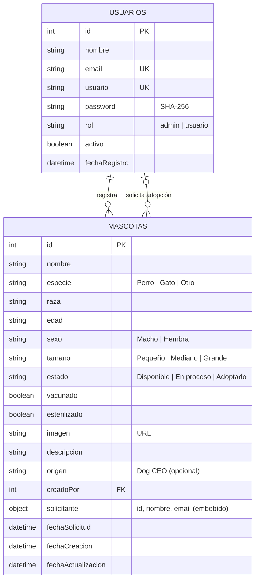

# 🐾 Patitas UTS

**Proyecto Corte 3 · Programación Web**
Unidades Tecnológicas de Santander (UTS) · Tecnología en Desarrollo de Sistemas Informáticos
Profesor: **Carlos Adolfo Beltrán Castro**

---

## 1. Presentación del proyecto

**Patitas UTS** es una aplicación web para una fundación de rescate y adopción de mascotas. Permite publicar los perros, gatos y otros animales rescatados que buscan hogar, consultar su información (edad, sexo, tamaño, vacunas, esterilización) y enviar solicitudes de adopción. También consume una API REST pública de razas de perros para ayudar a registrar nuevas mascotas.

La aplicación está construida con **HTML5 + Bootstrap 5 + JavaScript (Fetch API)** y utiliza **json-server** como base de datos no relacional (documentos JSON).

## 2. Integrante

| Nombre | Rol en el proyecto |
|---|---|
| Gabriela Martínez Suárez | Análisis, diseño, desarrollo completo (frontend, autenticación, CRUD, consumo de API REST) y documentación |

> Proyecto desarrollado de forma individual.

## 3. Temática

Gestión de adopción responsable de mascotas para una fundación de rescate animal del área metropolitana de Bucaramanga.

## 4. Objetivos

### Objetivo general
Desarrollar una aplicación web con control de acceso por perfiles que permita a una fundación gestionar las mascotas en adopción, los usuarios y las solicitudes, sobre una base de datos no relacional e integrando el consumo de una API REST pública.

### Objetivos específicos
- Implementar el registro e inicio de sesión de usuarios con contraseñas cifradas (SHA-256) y sesión en `localStorage`.
- Construir una base de datos no relacional con json-server para las colecciones `usuarios` y `mascotas`.
- Desarrollar los CRUD de usuarios y mascotas usando la Fetch API.
- Permitir que los usuarios soliciten la adopción de una mascota disponible.
- Consumir y documentar la API pública Dog CEO para consultar razas y fotos de perros.
- Diseñar una interfaz responsiva con Bootstrap que muestre siempre el logo, los datos del usuario, la fecha y la hora.

## 5. Justificación

Muchas fundaciones de rescate animal publican sus mascotas en redes sociales de forma desordenada: la información se pierde entre publicaciones, no se sabe cuáles ya fueron adoptadas y las solicitudes llegan por mensajes sueltos. Patitas UTS centraliza el catálogo de mascotas con su estado (disponible, en proceso, adoptado), separa los permisos entre quienes administran la fundación y quienes quieren adoptar, y registra cada solicitud. Así se promueve la adopción responsable y se facilita el trabajo de los voluntarios. Además, el proyecto aplica los temas del curso: HTML, frameworks de presentación, JavaScript asíncrono, peticiones HTTP (GET, POST, PATCH, DELETE), APIs REST y bases de datos NoSQL.

## 6. Requerimientos

### Requerimientos funcionales

| Código | Descripción |
|---|---|
| RF01 | El sistema permite registrar usuarios nuevos (nombre, correo, usuario y contraseña). Toda cuenta nueva queda con perfil *usuario global*. |
| RF02 | El sistema valida que el usuario y el correo no estén repetidos. |
| RF03 | El sistema permite iniciar sesión con usuario y contraseña, y bloquea cuentas inactivas. |
| RF04 | El sistema maneja dos perfiles: **Administrador** y **Usuario global**, y muestra el menú según el perfil. |
| RF05 | El menú del administrador contiene: Inicio, API REST, Artículos, Configuración, Contraseña y Salir. El usuario global ve todo excepto Configuración. |
| RF06 | **Inicio** regresa a la pantalla inicial con un resumen: mascotas registradas, disponibles, en proceso, adoptadas y usuarios. |
| RF07 | **API REST** consume la API pública Dog CEO: lista de razas y fotos aleatorias por raza. El administrador puede usar una foto para registrar una mascota. |
| RF08 | **Artículos** muestra el catálogo de mascotas en adopción con filtros por nombre, raza, especie y estado. El administrador puede registrar, editar y eliminar mascotas. |
| RF09 | El usuario global puede **solicitar la adopción** de una mascota disponible; esta pasa a estado *En proceso* y el administrador ve los datos del solicitante. |
| RF10 | **Configuración** permite al administrador el CRUD de usuarios (crear, listar, editar, activar/desactivar, cambiar perfil y eliminar) con Fetch. |
| RF11 | **Contraseña** permite al usuario cambiar su clave, validando la contraseña actual. |
| RF12 | **Salir** cierra la sesión y muestra un mensaje de despedida. |
| RF13 | Al ingresar se mantiene una plantilla con el logo del proyecto, los datos del usuario y la fecha y hora actual. |

### Requerimientos no funcionales

| Código | Descripción |
|---|---|
| RNF01 | **Seguridad:** las contraseñas se guardan cifradas con SHA-256; la sesión no almacena la contraseña; las páginas internas redirigen al login si no hay sesión; cada perfil solo accede a sus opciones. |
| RNF02 | **Usabilidad:** interfaz en español, mensajes claros de error y confirmación antes de eliminar o enviar una solicitud. |
| RNF03 | **Diseño responsivo:** se adapta a celulares, tabletas y computadores (Bootstrap 5). |
| RNF04 | **Rendimiento:** la API pública se consulta en grupos de 12 fotos. |
| RNF05 | **Mantenibilidad:** código organizado por módulos (un archivo JS por opción del menú) y comentado. |
| RNF06 | **Portabilidad:** funciona en navegadores modernos (Chrome, Edge, Firefox). |
| RNF07 | **Seguridad en la presentación:** los datos se escapan antes de mostrarse en pantalla para evitar inyección de HTML. |

## 7. Tecnologías

- HTML5, CSS3
- [Bootstrap 5.3](https://getbootstrap.com/) y Bootstrap Icons (framework de presentación)
- JavaScript ES6+ (Fetch API, async/await, Web Crypto API)
- [json-server 0.17.4](https://github.com/typicode/json-server) (base de datos no relacional / API REST local)
- [Dog CEO API](https://dog.ceo/dog-api/) (API REST pública)
- Git y GitHub

## 8. Estructura del proyecto

```
Patitas-UTS/
├── index.html            # Login y registro
├── app.html              # Aplicación (menú, plantilla y secciones)
├── package.json          # Script "npm start" para json-server
├── css/
│   └── styles.css
├── img/
│   └── logo.svg          # Logo del proyecto
├── db/
│   └── db.json           # Base de datos no relacional (usuarios y mascotas)
├── js/
│   ├── config.js         # URLs de json-server y de la API pública
│   ├── utils.js          # Sesión, cifrado, fetch y utilidades
│   ├── auth.js           # Login y registro
│   ├── app.js            # Menú por perfil, plantilla, reloj, navegación y salir
│   ├── inicio.js         # Opción Inicio
│   ├── apirest.js        # Opción API REST (consumo Dog CEO, documentado)
│   ├── mascotas.js       # Opción Artículos (CRUD de mascotas y solicitudes)
│   ├── configuracion.js  # Opción Configuración (CRUD usuarios)
│   └── password.js       # Opción Contraseña
└── docs/
    ├── API.md            # Documentación de la API pública y de la API local
    └── DER.md            # Diagrama entidad-relación de la base de datos
```

## 9. Instalación y ejecución

Requisito: tener instalado [Node.js](https://nodejs.org/) (versión 18 o superior).

```bash
git clone https://github.com/USUARIO/Patitas-UTS.git
cd Patitas-UTS
npm install
npm start
```

Luego abre en el navegador: **http://localhost:3000**

`npm start` levanta json-server en el puerto 3000; sirve al mismo tiempo la base de datos (`/usuarios`, `/mascotas`) y los archivos de la página. No se recomienda abrir el proyecto con Live Server, porque recarga la página cada vez que json-server guarda cambios en `db.json`.

### Cuentas de prueba

| Perfil | Usuario | Contraseña |
|---|---|---|
| Administrador | `admin` | `admin123` |
| Usuario global | `usuario` | `user123` |

## 10. Perfiles y menú

| Opción | Administrador | Usuario global |
|---|:---:|:---:|
| Inicio | ✅ | ✅ |
| API REST | ✅ (puede registrar mascotas desde una foto) | ✅ (solo consulta) |
| Artículos (mascotas) | ✅ CRUD y ve solicitudes | ✅ consulta y solicita adopción |
| Configuración (CRUD usuarios) | ✅ | ❌ |
| Contraseña | ✅ | ✅ |
| Salir | ✅ | ✅ |

## 11. Base de datos

Se usa **json-server**, que trabaja sobre el archivo `db/db.json` con dos colecciones (documentos JSON):

- `usuarios`: id, nombre, email, usuario, password (SHA-256), rol, activo, fechaRegistro.
- `mascotas`: id, nombre, especie, raza, edad, sexo, tamano, estado, vacunado, esterilizado, imagen, descripcion, origen, creadoPor, solicitante, fechaSolicitud, fechaCreacion, fechaActualizacion.



El detalle del modelo está en [`docs/DER.md`](docs/DER.md).

## 12. API REST

- **API pública:** Dog CEO, consumida en `js/apirest.js` (comentada paso a paso).
- **API local:** json-server expone `GET / POST / PATCH / DELETE` sobre `/usuarios` y `/mascotas`.

La explicación completa de endpoints, parámetros y respuestas está en [`docs/API.md`](docs/API.md).

## 13. Sustentación

📹 Video de sustentación: *[pegar aquí el enlace de YouTube o Google Drive]*

## 14. Licencia

Proyecto académico con fines educativos. Licencia MIT.
