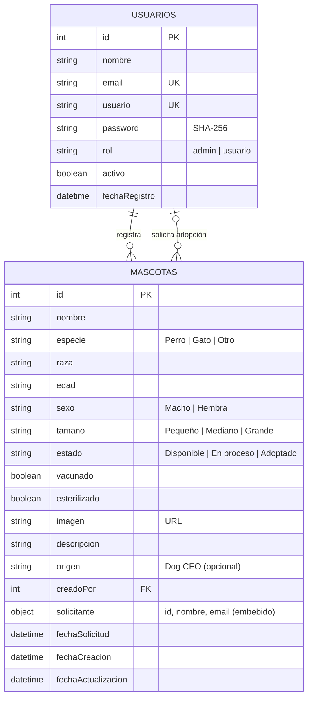

# Modelo de datos (DER) · Patitas UTS

La base de datos es **no relacional** (json-server sobre `db/db.json`). Cada colección es un arreglo de documentos JSON. Las relaciones se manejan de dos formas, como es común en NoSQL:

- **Por referencia:** `creadoPor` guarda el `id` del usuario que registró la mascota.
- **Documento embebido:** `solicitante` guarda una copia de los datos del usuario que pidió la adopción (id, nombre, email), para mostrarlos sin hacer otra consulta.

## Colección `usuarios`

| Campo | Tipo | Descripción |
|---|---|---|
| id | número | Identificador único (lo asigna json-server) |
| nombre | texto | Nombre completo |
| email | texto | Correo, único |
| usuario | texto | Nombre de acceso, único, en minúsculas |
| password | texto | Contraseña cifrada con SHA-256 |
| rol | texto | `admin` o `usuario` |
| activo | booleano | Si es `false`, no puede iniciar sesión |
| fechaRegistro | fecha ISO | Fecha de creación de la cuenta |

## Colección `mascotas`

| Campo | Tipo | Descripción |
|---|---|---|
| id | número | Identificador único |
| nombre | texto | Nombre de la mascota |
| especie | texto | Perro, Gato u Otro |
| raza | texto | Raza o "Criolla" |
| edad | texto | Edad aproximada (ej. "8 meses") |
| sexo | texto | Macho o Hembra |
| tamano | texto | Pequeño, Mediano o Grande |
| estado | texto | Disponible, En proceso o Adoptado |
| vacunado | booleano | Tiene vacunas al día |
| esterilizado | booleano | Está esterilizado(a) |
| imagen | texto | URL de la foto (opcional) |
| descripcion | texto | Personalidad, cuidados, historia |
| origen | texto | `Dog CEO` si la foto vino de la API pública |
| creadoPor | número | `id` del administrador que la registró |
| solicitante | objeto | Datos del usuario que solicitó la adopción |
| fechaSolicitud | fecha ISO | Fecha de la solicitud |
| fechaCreacion | fecha ISO | Fecha de registro |
| fechaActualizacion | fecha ISO | Última edición |
